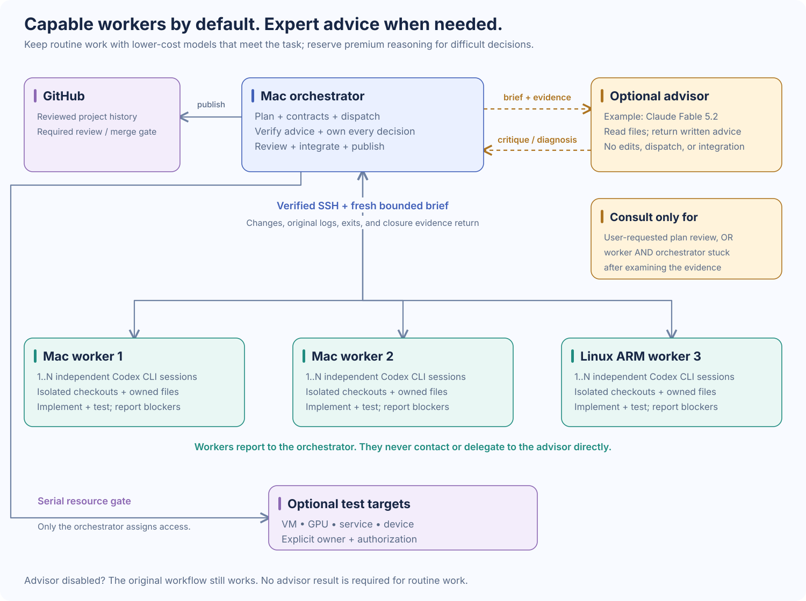

# CodexTandem

A practical guide to coordinating Codex CLI work across your own computers.

One orchestrator owns the plan, interfaces, review, integration, and publication. Workers run independent `codex exec` sessions over SSH, implement bounded tasks in isolated checkouts, and return changes with the original execution evidence. This is an instructed operating method: SSH connects the machines, and the orchestrator coordinates them.

An optional highly capable advisor, such as **Claude Fable 5.2**, adds a second opinion for requested plan reviews and problems that both a worker and the orchestrator cannot solve. The orchestrator remains in charge; the advisor reads evidence and recommends, then ordinary workers carry out the accepted work.

## Start here

1. [Set up hosts, SSH, authentication, and isolated workspaces](docs/SETUP.md).
2. [Choose GitHub access and understand its limits](docs/ACCESS.md).
3. [Dispatch, close, review, and integrate a task](docs/WORKFLOW.md).
4. [View the diagrams and edit their Mermaid sources](docs/DIAGRAMS.md).
5. Optional: [add a premium advisor for plan review and hard blockers](docs/ADVISOR.md).

## Optional advisor, selective spending

Use capable, lower-cost models for the work they can complete reliably. Reserve expensive reasoning for the difficult decisions and blockers where those models struggle, then return implementation to the workers. A focused premium consultation can reduce the overall cost of repeated failed attempts or rework; paying for the premium model on every routine task loses that advantage. Savings depend on the workload and have not been measured for this guide.

Consult the advisor in two cases:

- **Requested plan review:** the user explicitly asks the advisor to review a plan.
- **Unresolved problem:** a worker cannot solve the problem, and the orchestrator examines the evidence but also cannot resolve it or find a solution.

A worker reports its blocker to the orchestrator; it does not call the advisor directly. The advisor is optional, may still be unable to solve the problem, and does not replace tests or the orchestrator's judgment. When it is unavailable, report that fact and let the user choose whether to continue without the review or restore access or credits. See [Advisor setup and use](docs/ADVISOR.md) for the reference wrapper, limits, and examples.

## The operating rules

- Give each task one owner, a named base commit, a file boundary, and a testable outcome.
- Parallelize independent work. Separate physical machines, concurrent sessions, and shared resource capacity when planning.
- Keep worker context small. A follow-up is a fresh brief with the relevant contract, work delta, and outcomes.
- Close paid worker sessions during long downloads, model loads, and dependency waits. Reopen a fresh session when useful work is ready.
- Inspect original logs and native, wrapper, and outer exit statuses. Verify the submitted diff or bundle and process closure before integration.
- Label missing evidence `UNKNOWN`, partial evidence `PARTIAL`, and checks that were not run `NOT_TESTED`.
- Reserve time for integrated testing and rehearsal. Cut optional features when the deadline is threatened.
- Let the user choose the timebox. Keep working in the active orchestrator chat until the task is complete or the user changes the scope; there is no automatic three-hour handoff.

## What you need

The orchestrator and workers need Git, SSH, the project toolchain, and a separately authenticated Codex CLI. Use ordinary worker accounts and dedicated SSH keys. A shared GPU, VM, service, or device is an explicitly assigned resource; its lifecycle stays under the orchestrator's control unless the task authorizes an owner.

This repository contains documentation, diagrams, and an [optional advisor reference wrapper](examples/advisor/). Adapt the examples to your environment; it does not install a worker manager or launch sessions automatically. The core workflow needs no advisor or Anthropic account. Start with one worker and a small real task, then add parallel lanes only when their ownership and dependencies are clear.

The command examples follow [official OpenAI documentation for non-interactive mode](https://learn.chatgpt.com/docs/non-interactive-mode) and local CLI help checked on 2026-10-02. Check your installed version and available model identifiers before dispatch.

## Example task split

| Owner | Work | Exclusive boundary | Shared dependency |
| --- | --- | --- | --- |
| Orchestrator | Interface contract, review, integration, release | Default branch and release decisions | Integration environment |
| Optional advisor | Requested plan critique or diagnosis after worker and orchestrator are stuck | No file ownership, dispatch, or integration | Evidence supplied by the orchestrator; separate model account |
| Worker 1 | API implementation and unit tests | API module and its tests | Agreed interface contract |
| Worker 2 | UI implementation and component tests | UI module and its tests | Same contract; mock until API is ready |
| Worker 3 | Independent tool or adapter | Adapter module and its tests | Shared device access only through an assigned gate |

Multiple sessions on one physical worker can help when files and resources are disjoint. They still share that machine's CPU, memory, disk, and network. Adding hosts does not remove the serial integration and acceptance work.

## License

[MIT](LICENSE).
