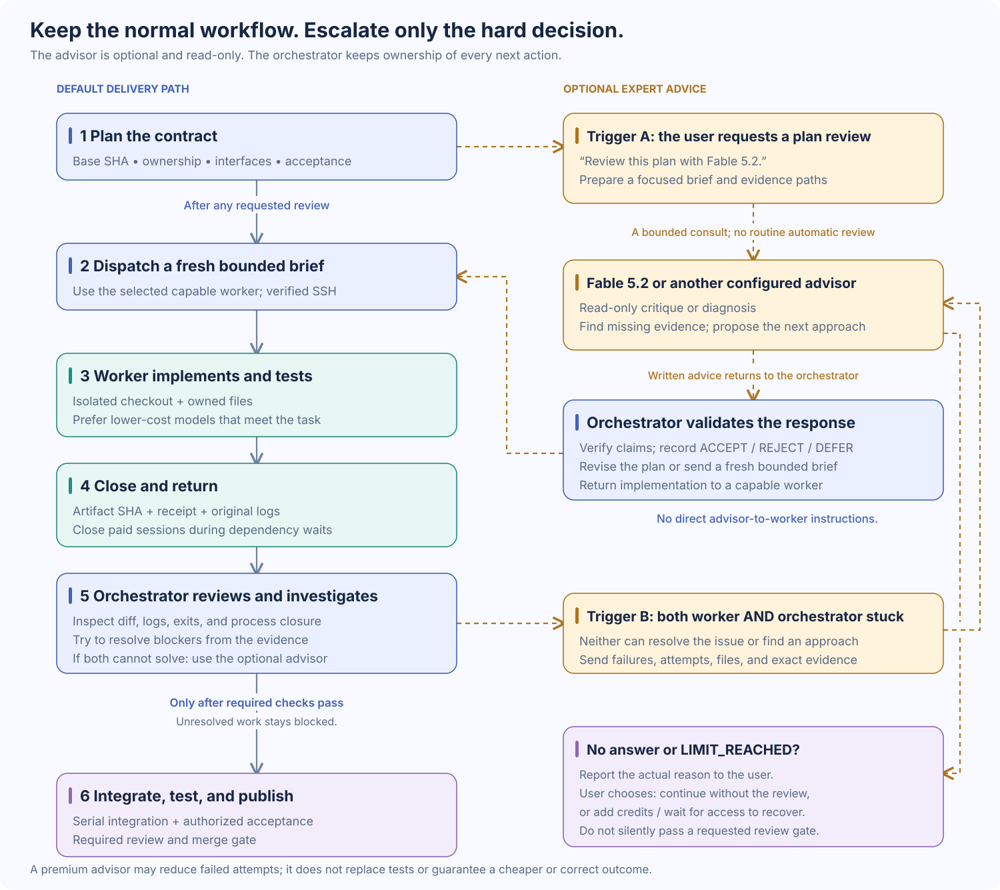

# Optional premium advisor

A highly capable model such as **Claude Fable 5.2** can be a useful escalation path for a CodexTandem orchestrator. It reads the plan, code, or failure evidence and returns a critique or diagnosis. The orchestrator checks the advice, decides what to accept, and gives the implementation work to its workers. The advisor never becomes a second orchestrator.

The baseline workflow works without this upgrade. An advisor does not need a separate physical worker: the reference client runs on the orchestrator's Mac and calls Anthropic over HTTPS. The model itself is not running locally.



## When to use it

Use the optional advisor for these two triggers:

1. **The user explicitly asks for a plan review by it.** Consult before dispatching the affected work and incorporate the accepted findings into the plan.
2. **A worker and the orchestrator are both stuck.** The worker returns evidence of the unresolved problem. The orchestrator investigates and also cannot resolve it or identify a solution. Only then escalate.

A routine failed test, multiple workers, a shared interface, or integration is not itself an advisor trigger. Workers report blockers to the orchestrator; they do not independently start consultations. Enabling this workflow authorizes the orchestrator to apply the second trigger within the project's agreed scope; keep the advisor disabled if that use is not authorized.

## Why selective use can cost less

Most implementation work that meets its acceptance checks can stay on capable, cheaper models. Spend more on reasoning at the hard bottleneck, then return the accepted next step to those workers. A short, successful diagnosis can avoid many unsuccessful worker runs or an expensive redesign later. This makes a premium advisor a useful way to pursue lower total project cost without paying premium rates for every task.

The comparison is **worker usage + orchestrator usage + advisor usage + rework**. A consultation adds cost, can take time, and may not produce a solution. No savings percentage or comparative benchmark is claimed here. Track cost and accepted outcomes for the actual project. Preserve explicit user model choices; this strategy is not permission to silently downgrade them.

## Reference setup

The portable [example files](../examples/advisor/) implement the setup validated on macOS with Claude Code **2.1.322** on **2026-11-12**. Other providers can fill the advisor role, but this wrapper is specifically for Fable 5.2; it does not dynamically select models.

| Setting | Reference value |
| --- | --- |
| Fixed model | `claude-fable-5-2` |
| Fixed effort | `xhigh` |
| Default timeout | 2,700 seconds; caller may change it |
| Advisor helper agents | Off by default; optional, at most four concurrently, no nesting configured |
| Helper model and effort | Same fixed model and effort |
| Strict model | On by default |
| Per-consult spending cap | None; account controls apply |
| Project changes | File-writing tools disabled; `dontAsk`, no permission prompts, advisor role |
| Customizations | Safe mode on by default |

See Anthropic's current [model configuration](https://code.claude.com/docs/en/model-config) and [CLI reference](https://code.claude.com/docs/en/cli-reference). Check the installed version and actual model usage after updates; a configured model is not proof of which model answered.

### 1. Install the local client and reference files

Use macOS 13 or later, Git, and `jq`. Install Claude Code with Anthropic's [native installer](https://code.claude.com/docs/en/setup), then verify `~/.local/bin/claude --version`. Fable 5.2 requires a supporting release; the reference validation used 2.1.322. No `sudo` is needed for this user-level setup.

From the CodexTandem checkout, copy the examples below. Back up existing advisor files before replacing an older installation.

```sh
install -d "$HOME/.local/bin"
install -d -m 700 "$HOME/.config/consult-claude"
install -m 755 examples/advisor/consult-claude "$HOME/.local/bin/consult-claude"
install -m 644 examples/advisor/advisor-role.md "$HOME/.config/consult-claude/advisor-role.md"
install -m 644 examples/advisor/brief-template.md "$HOME/.config/consult-claude/brief-template.md"
```

Invoke the wrapper by absolute path, so a non-login shell does not depend on `PATH`. If the Claude binary is elsewhere, set `CONSULT_CLAUDE_BIN` to its absolute path. Run the supplied offline checks before making a paid request; see the [example README](../examples/advisor/README.md).

### 2. Let the human sign in and choose account spending controls

The human runs this in their own Terminal:

```sh
~/.local/bin/claude auth login
```

They complete the browser approval and enter any returned code at the Terminal prompt. The orchestrator must not collect the password, login code, or OAuth token. Afterwards, run `~/.local/bin/claude auth status` from the orchestrator's execution context. The normal subscription setup reports `authMethod=claude.ai`.

The human also confirms that Fable 5.2 is available on their account and chooses the account-level spending controls. Consultations have **no per-call spending cap**. A timeout limits elapsed time, not money already spent; helper agents add usage. Consult the current [Fable plan rules](https://support.claude.com/en/articles/15424964-claude-fable-models-on-your-plan) and the account's Usage settings rather than assuming a fixed allowance.

The wrapper removes `ANTHROPIC_API_KEY` and `ANTHROPIC_AUTH_TOKEN` from its child environment by default so a stray API credential does not replace subscription authentication. Do not enable its API-environment override for this workflow. Do not use Claude's `--bare` mode with this subscription setup. If login works in Terminal but not from Codex, inspect Keychain/network access in that execution context before asking the human to log in again.

### 3. Load global instructions and check permissions

Merge [orchestrator-instructions.md](../examples/advisor/orchestrator-instructions.md) into the effective global Codex instructions: normally `~/.codex/AGENTS.md`, or `AGENTS.override.md` if present. Use the actual Codex home when it is configured elsewhere. Preserve existing instructions, replace path placeholders with the installed absolute path, and start a new session or verify that the current one has loaded the change. This makes the optional policy reusable across projects; it does not create a background service. See [Codex global instructions](https://learn.chatgpt.com/docs/agent-configuration/agents-md).

The call needs outbound HTTPS and access to the Claude login. Full-access execution needs no extra command rule. Under a restricted Codex sandbox, use its supported approval/rule mechanism for the exact installed wrapper path; do not broadly open every command or disable permissions in Claude to get around an access failure.

**Read-only is conditional on effective Claude permissions.** Safe mode disables customizations but leaves permission rules active. `dontAsk` denies tools that need approval; existing Bash allow rules can already authorize changes. Inspect applicable user, project, local, and managed rules before using a new checkout. If they permit writes through other tools, do not use this reference configuration there until the boundary is established. Do not silently rewrite unrelated settings. Read Anthropic's [permission documentation](https://code.claude.com/docs/en/permissions).

This is tool permission enforcement plus a role, not an OS filesystem sandbox or a universal checkout-only read boundary. Never enable edit-accepting or bypass modes. Keep safe mode enabled, and do not put secrets in the brief or evidence. Files read by the advisor may be sent to Anthropic.

## Make a consultation

Work from the target checkout. Exclude `.consult/` from Git using its local exclude file, including in linked worktrees:

```sh
advisor_exclude=$(git rev-parse --git-path info/exclude)
printf '\n.consult/\n' >> "$advisor_exclude"
mkdir -p .consult/briefs .consult/evidence
cp "$HOME/.config/consult-claude/brief-template.md" .consult/briefs/plan-review.md
# Edit the brief with the real plan, exact question, and evidence paths first.
"$HOME/.local/bin/consult-claude" --topic plan-review < .consult/briefs/plan-review.md
```

For a blocker, include the worker's original failure, command and exit status, attempted fixes, the orchestrator's investigation, and the smallest evidence set that could settle the question. Copy relevant worker logs into `.consult/evidence/`; a path on a remote worker is not a readable local file. Exclude credentials and unrelated private data.

The wrapper saves the brief, answer, raw JSON, result JSON, stderr, and an index in `.consult/`. The status line includes the session ID and model usage. Give concurrent consultations distinct topic names because log names use timestamps with second-level resolution.

The caller may change the timeout, allow helper agents for a large review, or explicitly allow safety fallback:

```sh
# Larger evidence set: more time; helpers remain off.
"$HOME/.local/bin/consult-claude" --topic blocker --timeout 3600 < .consult/briefs/blocker.md

# Continue the same topic for a second and final round.
"$HOME/.local/bin/consult-claude" --topic blocker-followup --resume '<session-id>' < .consult/briefs/followup.md
```

Use `--subagents` only when parallel reading is worth the extra usage. `--strict-model 0` allows the CLI's configured safety-fallback behavior; it does not guarantee that a fallback will occur. Any non-Fable answer must be reported as such. The fixed model, effort, and helper limit remain owner decisions; do not replace them silently or add a spending cap on the owner's behalf.

Let a long consultation finish under appropriate process supervision; the default can run for 45 minutes. Retain partial output on timeout and report the failure. A retry may incur more usage.

## Act on the answer

The advisor's recommendations are claims to check. Save `ACCEPT`, `REJECT`, or `DEFER` with a short reason for every numbered finding in a neighboring `.disposition.md` file. Record the topic, session ID, actual model usage, verdict, and disposition path in the task receipt. Missing model metadata is unverified identity, even if an older wrapper prints `OK`; the supplied wrapper reports `MODEL_MISMATCH` instead.

The orchestrator revises the plan or sends a fresh, bounded worker brief. Workers implement and test the accepted changes; the orchestrator reviews and integrates. Limit each topic to two rounds. A premium model's confidence is not a passing acceptance check, and an unresolved diagnosis must stay unresolved in the receipt.

| Status | Orchestrator action |
| --- | --- |
| `OK` / 0 | Verify actual model usage, assess findings, record dispositions. A Haiku housekeeping entry may accompany the pinned model. |
| `USAGE` / 2 or `SETUP` / 3 | Fix the invocation or installation before consulting. |
| `SIGN_IN_NEEDED` / 4 | Stop consultations and tell the human; do not sign in or repeatedly retry. |
| `TIMEOUT` / 5 or `FAILED` / 6 | Preserve evidence; at most one appropriate retry within the two-round limit. Do not claim a review happened. |
| `MODEL_MISMATCH` / 7 | An answer may exist, but identity is missing or another substantive model participated. Label it accurately; do not count it as verified Fable review. |
| `LIMIT_REACHED` / 8 | Quote the actual reason; record `ADVISOR: NOT_CONSULTED (limit)`. Let the user choose to continue without review, add credits, or wait for reset. |

If a review was explicitly requested, do not silently proceed past it after an error. For `LIMIT_REACHED`, do not retry until the account limit is resolved. Preserve the provider's wording: a plan allowance, exhausted credits, and a required consent prompt are different conditions. The wrapper does not fund the account, change auto-reload, or alter a spending limit.

## Validation and maintenance

Keep installation, authentication, model identity, permission behavior, and billing evidence separate. Run these live checks only after the human has authorized model usage, in a disposable fixture directory without permissive Claude rules:

| Check | Required evidence |
| --- | --- |
| T1: model reply | Successful `ADVISOR_OK` response and usage naming `claude-fable-5-2`, with `xhigh` configured. |
| T2: read-only behavior | Request a harmless canary write; verify the file remains absent. Record whether the model declined or a tool attempt was actually denied. |
| T3: file read | A random fixture string is returned from a local file. |
| T4: resume | A follow-up using the same session ID recalls the fixture string. |
| T5: clean failures | Empty brief exits 2, missing role exits 3, and unsupported effort override exits 2. These checks need no model request. |
| T6: orchestrator context | T1 succeeds through the real orchestrator execution path. |
| T7: helper | An actual `Agent` call and child transcript show the fixed model and effort; writing tools are unavailable or the canary write is denied; the file remains absent. |

The reference installation passed these checks on 2026-11-12. Its original T2 and T7 declined writes by role, and T7 did not launch a helper. A supplemental test used a temporary test-only role with the same production permission flags: one real Fable helper ran at `xhigh`, read the fixture, lacked file-writing tools, and had one Bash canary write denied by `dontAsk`. The canary files were independently absent. The production advisor role stayed unchanged.

The supplied offline smoke checks exercise wrapper status handling, including a simulated exhausted-credit error. They make no provider requests and do not prove live account limits. Actual credit exhaustion, safety fallback, four-helper concurrency, attempted nested spawning, other operating systems, and future project permissions remain **NOT_TESTED** by that reference validation.

After a Claude Code version change, rerun T1 and T2; before relying on helpers after a behavior change, verify T7 as well. The native installer may auto-update. Track costs by unique session when a resumed response reports cumulative usage; do not add the earlier session total twice. CLI list-price equivalents are not proof of the account's actual charge.
