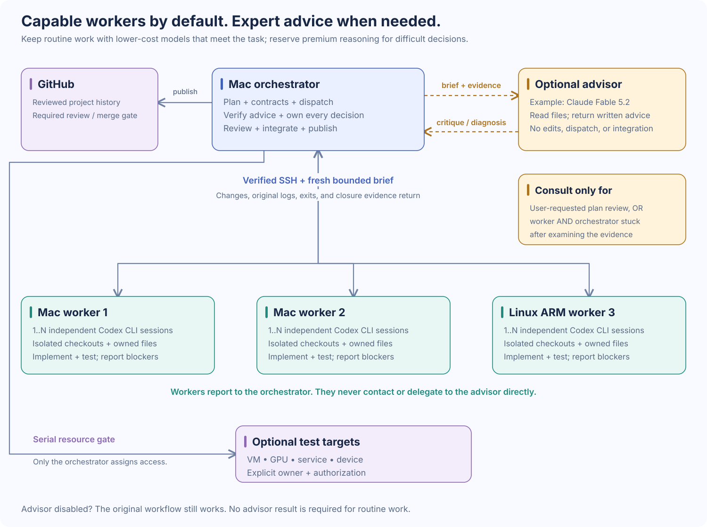
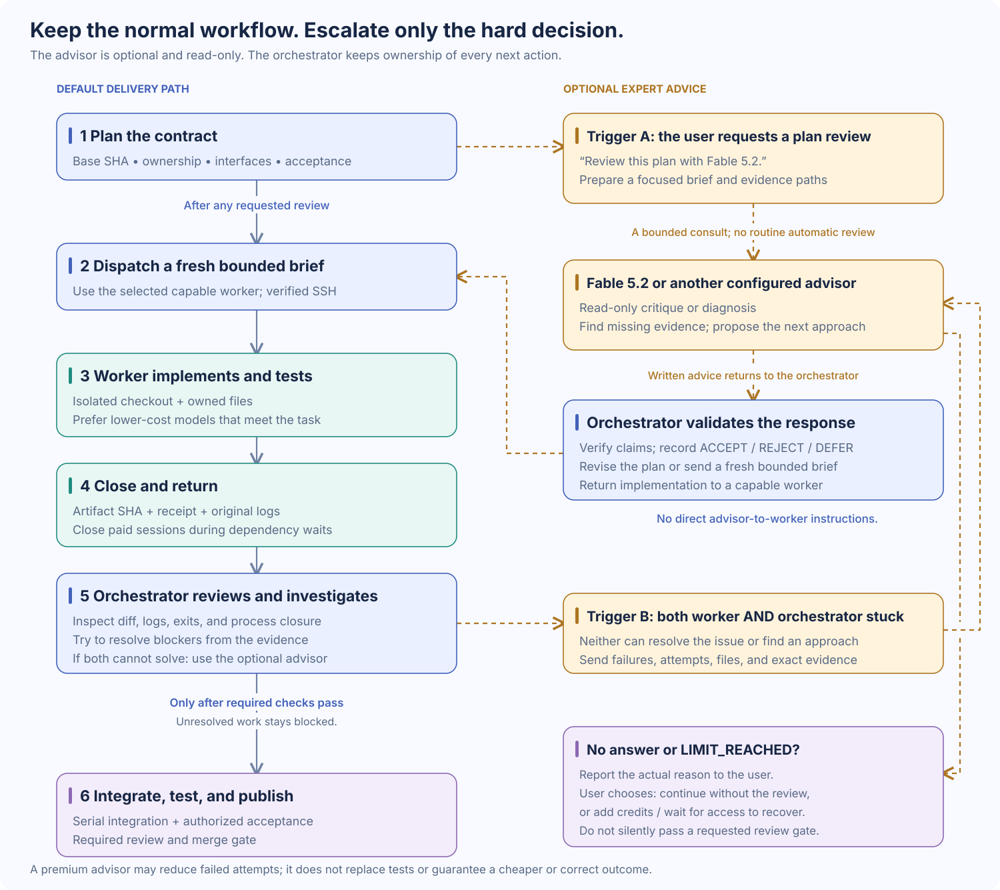
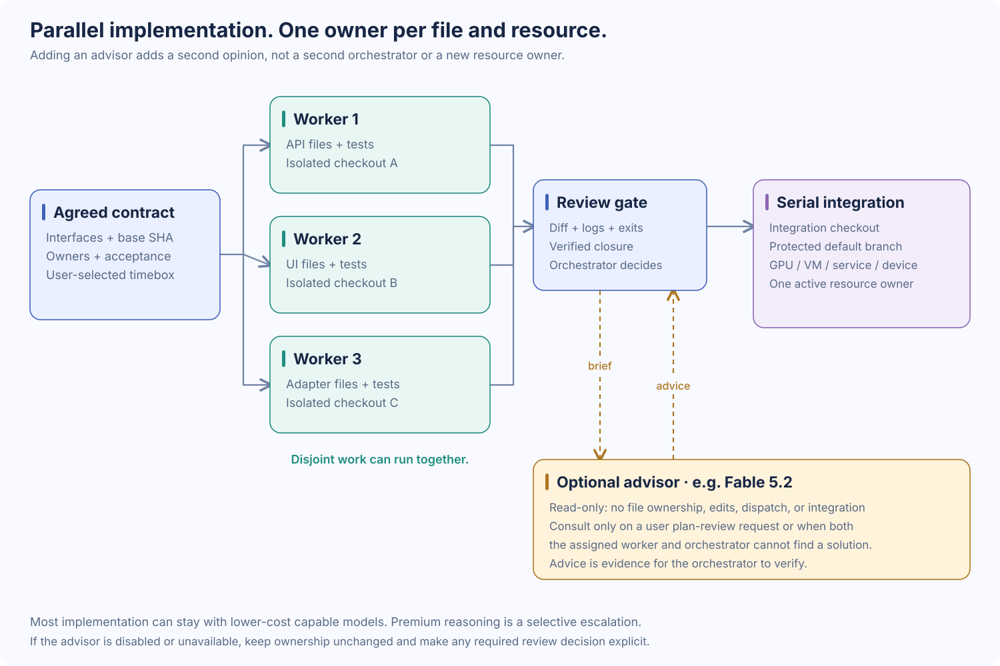

# Diagrams

The SVGs are readable previews for Markdown and sharing. The matching Mermaid files are editable source. They describe this operating method rather than an automatically provisioned cluster. Amber boxes and dashed arrows show the optional expert advisor; the blue orchestrator and green worker path remains usable without it.

## Host topology

[Editable Mermaid source](diagrams/topology.mmd)

The orchestrator has direct SSH access to each ordinary worker account. Each worker runs independent Codex CLI sessions in isolated checkouts. GitHub stores reviewed project history. Optional VM, GPU, service, and device targets are separate resources with an explicit owner and authorization.

An optional highly capable advisor, such as Fable 5.2, connects only to the orchestrator. It receives a focused brief and evidence and returns a critique or diagnosis. It does not own files, dispatch workers, integrate changes, or publish. Workers report blockers to the orchestrator, never directly to the advisor.

## Task lifecycle

[Editable Mermaid source](diagrams/workflow.mmd)

The important gate is between a returned result and integration: inspect the original exits and logs, verify the diff or bundle, and prove the exact task process group is closed. Long waits use ordinary tooling; another useful worker session begins with a fresh brief.

The optional advisor has two main entry points:

1. The user explicitly asks for a plan review by the advisor.
2. An assigned worker and the orchestrator both cannot resolve the issue or find a workable approach after examining the evidence.

The orchestrator verifies the advice, records its disposition, and sends any implementation work back to a capable worker with a fresh bounded brief. If the advisor is unavailable, including `LIMIT_REACHED`, the orchestrator reports the actual reason and lets the user choose whether to continue without the requested review or resolve access or credits and retry. A missing answer never silently passes a requested review gate.

## Ownership and shared resources

[Editable Mermaid source](diagrams/ownership.mmd)

Different workers can implement independently against one agreed contract. Shared integration state and runtime resources remain serialized. Physical hosts, concurrent sessions, and shared resource slots are different planning dimensions. The optional advisor adds a second opinion without changing any ownership boundary.

Use lower-cost capable models for ordinary implementation where they meet the task requirements, while preserving exact user model selections. Selective premium reasoning can reduce repeated failed attempts on hard problems; it is not a measured savings guarantee and does not replace acceptance tests. See [Optional advisor](ADVISOR.md) for setup and use.

## Editing

Edit `.mmd` for Mermaid renderers, or edit the SVG directly with a vector editor or text editor. Keep labels consistent with [Workflow](WORKFLOW.md) and [Optional advisor](ADVISOR.md). The SVG files use native vector shapes and text, have no script or external asset dependencies, and can be opened directly in a browser.
